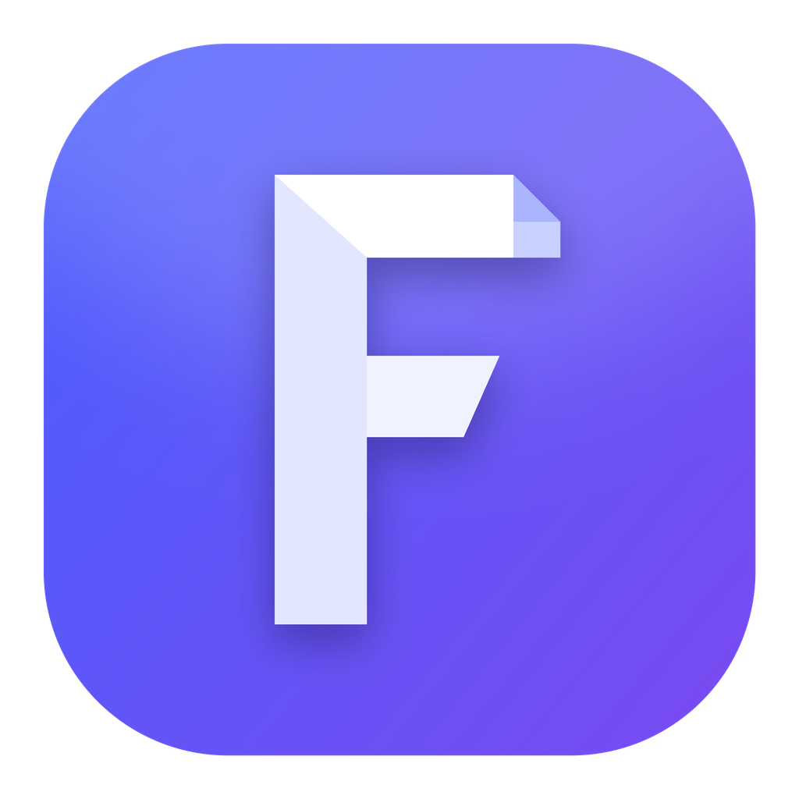

<p align="center"></p>

<h1 align="center">Folio</h1>

<p align="center">Минималистичный редактор документов для Windows</p>

## Что умеет

- Открывает и сохраняет **.docx**, **.txt**, **.md**, **.html** — без Microsoft Word.
- Экспорт в Word, OpenDocument, PDF, RTF, HTML, Markdown и TXT.
- Проекты и папки как в Канве — это обычные папки в «Документы\Folio».
- Списки как в Word, список дел с галочками, ссылки (Ctrl+K), таблицы, картинки.
- Стикеры поверх документа: заметки, дедлайны, фото, ссылки и стрелки между ними. Они видны только в Folio и не попадают в экспорт.
- Стеклянная панель, светлая и тёмная тема, свои цвета, шрифты и формы.

## Установка

1. Открой страницу [Releases](../../releases/latest) и скачай **Folio-windows.zip**.
2. Распакуй его (правой кнопкой → «Извлечь всё»).
3. Запусти **Install.bat**.

Python не нужен. Дальше Folio сам предложит обновиться, когда выйдет новая версия, а настройки и документы при этом сохранятся.

## Для разработки

```
pip install pyside6-essentials python-docx
python folio.py
```

Новая версия: поменять `APP_VERSION` в `folio.py` и отправить изменения в `main`. GitHub соберёт Folio.exe и выпустит релиз сам.
